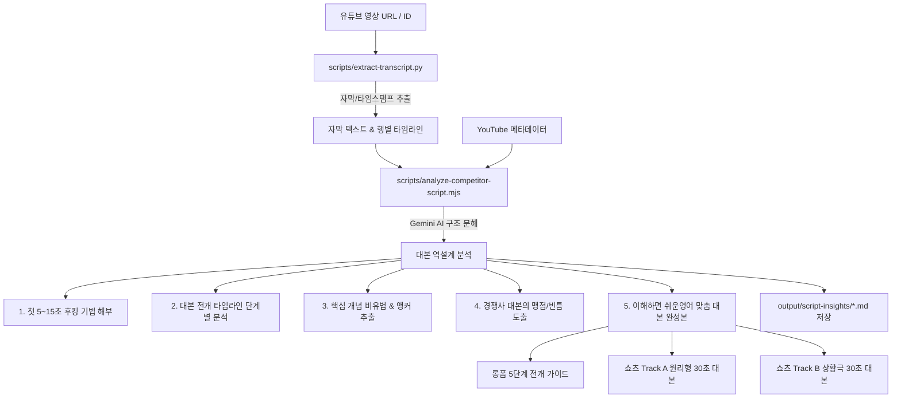

# 경쟁 채널 대본·자막 역설계 및 AI 맞춤 대본 생성 파이프라인

마지막 갱신: 2026-08-29

## 배경 및 필요성

유튜브 영어 교육 시장에서 아웃라이어(Outlier) 영상을 발굴했을 때, **댓글 분석(VoC)**만으로는 시청자의 갈증과 결핍(Demand)만 파악할 수 있고, **"그 영상을 시청자가 끝까지 시청하게 만든 논리 구조와 연출 호흡(Retention & Delivery)"**은 알 수 없다.

따라서 경쟁 영상의 **자막/스크립트(Transcript)를 추출하여 전개 공식을 역설계(Reverse-Engineering)**하고, 이를 우리 채널(**'이해하면 쉬운영어'**: 5060 시니어 눈높이, 시각적 자막 카드, 직관적 소리 변신 원리)의 강점과 결합하여 **10배 더 뛰어난 신규 대본 템플릿**을 자동 생성하는 파이프라인을 구축했다.

---

## 파이프라인 아키텍처

---

## 주요 구현 모듈

1. **`scripts/extract-transcript.py`**:
   - `youtube_transcript_api`를 기반으로 한국어/영어 자막 및 자동 생성 자막을 타임스탬프(초 단위)와 함께 추출.
2. **`scripts/analyze-competitor-script.mjs`**:
   - Gemini AI (`gemini-2.5-flash`)를 활용한 대본 역설계 분석 및 우리 채널 맞춤 대본 생성.
   - 분석 결과 JSON 및 Markdown 리포트 자동 저장.
3. **Cyber-HUD 대시보드 연동 (`scripts/youtube-analytics-server.mjs`)**:
   - `🤖 아웃라이어 영상 댓글 & 대본 AI 심층 분석실` 탭에 **서브탭 전환 UI (`💬 댓글 VoC 분석` vs `📜 대본 역설계 분석`)** 제공.
   - 시장 수요 레이더(`market-demand`)의 아웃라이어 카드에서 `[💬 댓글]` 및 `[📜 대본]` 1-Click 원클릭 분석 버튼 지원.
   - 생성된 대본 역설계 리포트 아카이브 및 전문 열람/클립보드 복사 모달 제공.
